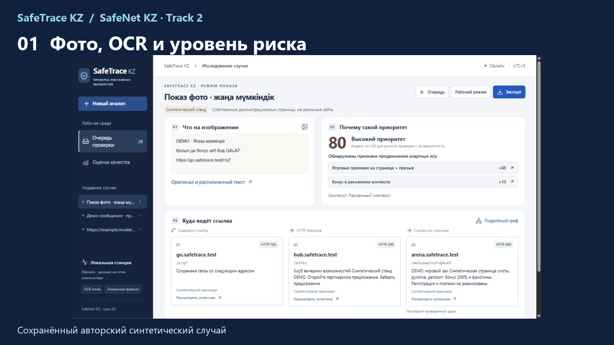

# SafeTrace KZ · Скрытая игра

**SafeNet KZ · трек 2.** Находим признаки скрытого продвижения азартных игр в сообщениях и скриншотах, восстанавливаем маршрут ссылки и показываем источники каждого вывода для проверки аналитиком.

- **Честная оценка:** ядро [заморожено до измерения v5](reports/versions/synthetic-v5/core-freeze.json); [протокол и результат v5](docs/METRICS.md) доступны для проверки.
- **Рабочая очередь:** Redis и [измеренные 1→4 воркера](docs/SCALE_BENCHMARK_V5.md): текст **22,94→41,00 случая/с**, OCR **0,434→0,662 изображения/с** на 4 vCPU.
- **Сеть материалов:** [5000 авторских сущностей](docs/NETWORK_V5.md), сильные и слабые связи, эксперимент Louvain, строгая группировка и PageRank с переходом к источнику.

**Қазақша:** Жасырын құмар ойын жарнамасының белгілерін мәтіннен және суреттен табамыз. Әр нәтиже дереккөзге апарады; соңғы шешімді талдаушы қабылдайды.

**English:** Trace suspected gambling promotion from a post or screenshot through its links and evidence. The analyst can inspect each claim before deciding.

 · [Онлайн-демо: OCR и маршрут](https://nurbolidze121212.github.io/safetrace-kz/#workspace) · [Релиз 3.0](https://github.com/nurbolidze121212/safetrace-kz/releases/tag/v3.0.0) · [Питч на казахском](deliverables/kazakh-jury-2026-10-25/PITCH_V5_KK.md) · [MIT](LICENSE)

| Замороженный synthetic-v5, полный процесс | FPR | Precision | Recall |
|---|---:|---:|---:|
| 640 случаев | **4,8%** (20/420) | **89,2%** (166/186) | **75,5%** (166/220) |

**Оговорка:** это авторский синтетический набор с разметкой LLM, без человеческой проверки; интервалы Wilson, ошибки, протокол и границы применимости — в [METRICS](docs/METRICS.md).

| Критерий ТЗ | Где проверить |
|---|---|
| Точность, 30% | [Матрица ошибок и срезы](docs/METRICS.md) |
| Объяснимость, 20% | [Экран OCR → маршрут → источник](https://nurbolidze121212.github.io/safetrace-kz/#workspace) |
| Инновационность, 20% | [Сеть, основания рёбер, Louvain и PageRank](docs/NETWORK_V5.md) |
| Практичность, 15% | [Демо со своим вводом](https://nurbolidze121212.github.io/safetrace-kz/#try) · [этика](ETHICS.md) |
| Масштабирование, 10% | [Очередь и фактический замер воркеров](docs/SCALE_BENCHMARK_V5.md) |
| Презентация, 5% | [Питч на 5 минут](deliverables/kazakh-jury-2026-10-25/PITCH_V5_KK.md) · [релиз 3.0](https://github.com/nurbolidze121212/safetrace-kz/releases/tag/v3.0.0) |

## За минуту: посмотреть и запустить

1. [Откройте онлайн-демо](https://nurbolidze121212.github.io/safetrace-kz/#workspace): первым показан сохранённый скриншот, OCR, риск, маршрут и цитаты. Затем [вставьте свою ссылку или текст](https://nurbolidze121212.github.io/safetrace-kz/#try).
2. Для полного OCR и досье на своём компьютере: `docker compose up -d`, затем **http://127.0.0.1:8765**. [Установка, платформы и данные](docs/DOCKER.md).
3. [Видео релиза 3.0](https://github.com/nurbolidze121212/safetrace-kz/releases/download/v3.0.0/SafeTrace-KZ-v3-demo-2min.mp4) · [архив исходников](https://github.com/nurbolidze121212/safetrace-kz/releases/download/v3.0.0/SafeTrace-KZ-v3.0.0-source.zip) · [казахские слайды](deliverables/kazakh-jury-2026-10-25/SafeTrace-KZ-Track2-v5-r2-KK.pptx).

Онлайн-форма проверяет адрес ограниченным обходом до 4 переходов; текст считает в браузере. Сохранённый пример показывает полный путь с OCR. Новое фото и полный анализ доступны в локальном приложении. [Сравнение возможностей](docs/LOCAL_AND_ONLINE.md).

## Что внутри

Приём текста, фото, Telegram JSON и SRT → извлечение URL/QR/OCR → контекст RU/KK и рекламные признаки → ограниченный маршрут → сеть с источниками → очередь ручной проверки и экспорт ZIP. [Архитектура](docs/ARCHITECTURE.md) · [Доказательства по критериям](docs/CRITERIA_TO_EVIDENCE.md) · [Документация и история](docs/README.md) · [Этика](ETHICS.md).

Автор: Nurbol Zhuman; разработка с AI-инструментами. [Лицензия кода MIT](LICENSE); [лицензии зависимостей и моделей](docs/SOURCES_AND_LICENSES.md).
