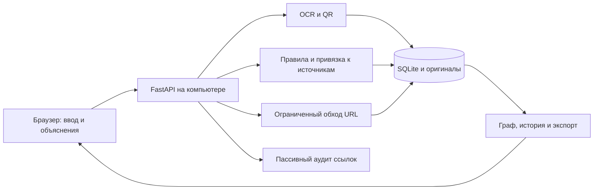

# SafeTrace KZ

**Сообщение или скриншот → адреса → маршрут → проверяемые основания → решение человека.**

SafeTrace KZ — локальная исследовательская программа для проверки подозрительных материалов. Основной измеренный сценарий — скрытое продвижение азартных игр, трек 2 «Скрытая игра» SafeNet KZ. Приложение **2.3.0** добавляет экспериментальный пассивный разбор других признаков угроз: подмены имени домена, адресов загрузки программ и сочетания обещания приза с запросом пароля или SMS-кода.

**Қазақша:** SafeTrace хабарламадағы жасырын жарнама мен күмәнді белгілерді түсіндіреді. Мәтін, сілтеме немесе сурет беріңіз: жүйе сақталған деректерге сүйеніп, тексеру жолын көрсетеді. Соңғы шешімді адам қабылдайды.

**English:** A local evidence workbench for hidden gambling promotion, with an experimental passive URL audit. Findings link to source material; missing evidence remains visible. No claim of universal scam detection or calibrated risk probability.


## Задача и ценность

Сообщение «забери бонус» может не содержать слова «казино». Ссылка проходит через посредника и только затем приводит к игровому предложению. Обратная ситуация — новость или предупреждение, где те же слова не являются рекламой. SafeTrace сохраняет материал, показывает проверенные переходы и связывает вывод с конкретными фрагментами.

Сценарий «вы выиграли iPhone, пришлите код» требует другого анализа. Признаки казино, признаки обмана, репутация URL и принадлежность организации не объединяются в одно число. [Границы расширенной проверки](docs/EXTENDED_ANALYSIS.md).

## Реализовано и запланировано

| Возможность | Фактическое состояние |
|---|---|
| Текст, URL, PNG/JPEG/WebP, вставка картинки, JSONL | Работает локально |
| OCR и QR, оригиналы и координаты | Работает; сомнительные адреса требуют явной сверки |
| Признаки скрытого продвижения RU/KK | rules-4.0; измерено на авторском синтетическом наборе |
| HTTP-переходы и ссылки на страницах | Ограниченный обход разрешённых узлов; видимые остановки |
| Карта, основания и связанные материалы | Каждый шаг открывает сохранённый источник |
| История, решение, HTML/JSON/оригиналы в ZIP | Работает; manifest с размерами и SHA-256 |
| Пассивный аудит URL и узких признаков обмана | **Новый экспериментальный модуль** link-audit-1.0; отдельный JSON |
| Справочник доменов брендов | Один проверенный пример Apple; не полный каталог казино |
| Актуальные базы фишинга/вредоносных URL | **Не подключены**; описан протокол интеграции |
| Антивирус, запуск JavaScript, анализ поведения файла | **Не реализованы** |
| Подтверждение владельца, лицензии и выплат казино | **Не выполняется** |
| Телефон | Адаптивная вёрстка проверена; сопряжение и физический телефон ещё не проверены |
| Расширение браузера / чтение WhatsApp | **Не реализованы**; материал добавляется вручную |

## Что означает 80 или 100

Основной индекс **0–100 — приоритет ручной проверки, а не вероятность**. Игровые признаки на странице вместе с относящимся к ней призывом дают +65; бонус в рекламном контексте — +15. Результат 80 не означает «80% мошенничество». Даже индекс 100 не подтверждает преступление, вирус, владельца или лицензию.

В дополнительном аудите процент не выводится: для этих угроз пока нет отдельного корпуса и калиброванной модели. Показываются признаки, источники и состояние каждой проверки. [Методика](docs/METHODOLOGY.md) · [Исследовательское досье](docs/RESEARCH_DOSSIER.md).

## Быстрый запуск

Нужны Windows x64, Python **3.12 x64**, Node.js **22.12+**. Проверенные версии: Python 3.12.14 и Node 24.13.1. Первичная установка требует интернета. Распакуйте исходники в ASCII-путь, например `C:\SafeTrace-KZ`.

```powershell
cd C:\SafeTrace-KZ
powershell -NoProfile -ExecutionPolicy Bypass -File .\scripts\setup.ps1
powershell -NoProfile -ExecutionPolicy Bypass -File .\scripts\start.ps1 -Offline -Background
```

Откройте **[http://127.0.0.1:8765](http://127.0.0.1:8765)**. Один локальный процесс отдаёт сайт и API. Остановка:

```powershell
powershell -NoProfile -ExecutionPolicy Bypass -File .\scripts\stop.ps1
```

[Установка, проверка и перенос на другой компьютер](docs/INSTALL_AND_TRANSFER.md). Офлайн-режим не проверяет внешние сайты; демонстрационные `.test` обслуживаются собственным синтетическим транспортом.

## Первый показ за три шага

1. Нажмите **«Проверить сообщение»**. В «Название, источник и настройки» выберите **«Синтетический стенд»**, загрузите `examples/import/picture.png`, оставьте поля текста и URL пустыми.
2. После OCR откроется режим показа: фото, рассчитанный приоритет, причины и карта. Нажмите причину или узел, откройте оригинал. На одном проверенном проходе фото обрабатывалось 12,4 с; это не гарантия времени любого файла.
3. Откройте **«Другие признаки: подмена домена и запросы кодов»**. Посмотрите выполненные и невыполненные проверки. Основное досье скачивается через «Экспорт», дополнительный аудит — через «Скачать JSON».

Пассивный пример: `Вы выиграли iPhone! Отправьте код из SMS: https://apple.com.claim.example/prize`. Это вымышленный адрес на зарезервированном `.example`, сеть не нужна. Контрпример: `Предупреждение: фраза «Вы выиграли iPhone! Отправьте код из SMS» — обман.` [Сценарий защиты](docs/MESSAGE_DEMO.md).

## Результаты измерений

Итоговый набор v4: **80 новых авторских синтетических случаев**, 40 положительных / 40 отрицательных, 32 изображения. Одинаковые входы для v3 и v4; независимой человеческой разметки нет.

| Метрика | v3 | v4 |
|---|---:|---:|
| TP / FP / TN / FN | 31 / 9 / 31 / 9 | 30 / 2 / 38 / 10 |
| Precision | 77,5% | **93,75%** |
| Recall | 77,5% | **75%** |
| False positive rate | 22,5% | **5%** |
| Recall на изображениях | 75% | **62,5%** |

Цели precision ≥95% и recall ≥80% не достигнуты. Шесть положительных отказов включены в FN. Подсказка для ручного уточнения OCR не считается автоматическим успехом. Эти метрики **не измеряют новый аудит угроз**. [Протокол](docs/EVALUATION_PROTOCOL_V4.md) · [оценка](reports/EVALUATION_V4.md) · [все ошибки](reports/ERROR_ANALYSIS_V4.md).

## Сервер у вас, браузер — интерфейс



Ключи, модели и база находятся на сервере. GitHub хранит исходники, но сам не запускает этот Python-сервер. Статический сайт без API не выполняет анализ. Другой ПК может стать самостоятельным сервером; подключение телефона требует отдельного режима доступа. [Архитектура](docs/ARCHITECTURE.md).

## Документация

| Вопрос | Материал |
|---|---|
| Проблема, гипотезы, эксперименты и ограничения | [Исследовательское досье](docs/RESEARCH_DOSSIER.md) |
| Скачать, запустить, перенести, восстановить | [Установка и перенос](docs/INSTALL_AND_TRANSFER.md) |
| Сервер, данные, ограничения сети | [Архитектура](docs/ARCHITECTURE.md) |
| Другие угрозы, реальные источники, API | [Расширенный анализ](docs/EXTENDED_ANALYSIS.md) |
| Показ продукта | [Демонстрация](docs/MESSAGE_DEMO.md) |
| Подготовка GitHub | [Публикация](docs/GITHUB_PUBLICATION.md) |
| Реально выполненные проверки 2.3.0 | [Отчёт](reports/LINK_AUDIT_2_3.md) |
| Следующие шаги | [Дорожная карта](docs/ROADMAP.md), [ночные итерации](NIGHT_IMPROVEMENT.md) |
| Прежняя защита v4 | [PDF](output/pdf/SafeTrace-KZ-report-v4.pdf), [слайды](deliverables/SafeTrace-KZ-defense-v4.pptx), [архив README](README_V4.md) |

## Разработка и проверка

```powershell
.\.venv\Scripts\python.exe -m pytest -q
.\.venv\Scripts\python.exe -m ruff check backend tests scripts
npm.cmd --prefix frontend test
npm.cmd --prefix frontend run lint
npm.cmd --prefix frontend run build
.\.venv\Scripts\python.exe scripts\preflight.py --server
```

Для 2.3.0 выполнено **330 backend-тестов и 30 frontend-тестов**. Они проверяют поведение кода, а не заменяют независимую оценку точности. API-схема доступна у запущенного сервера в `/docs` и `/openapi.json`.

`backend/` — сервер; `frontend/` — интерфейс; `tests/` — проверки; `fixtures/` — собственный стенд и справочник; `datasets/` — авторские наборы; `reports/` — измерения; `scripts/` — установка и обслуживание; `docs/` — объяснения. Модели скачиваются по `models-manifest.json` с проверкой SHA-256.

## Данные и воспроизводимость

Рабочая база, пользовательские оригиналы, `.env`, ключи, журналы и окружения исключены из Git. Локальный режим не отправляет материалы в облако. Режим Gemini отдельно отмечен в форме и требует серверного ключа; его живой вызов в приёмке не проверен.

Исходники и данные передаются отдельно. [Резервирование](docs/BACKUP.md) проверяет SQLite, SHA-256 и исторические изображения. Хеш подтверждает целостность байтов, а не истинность заключения.

[Лицензии компонентов и происхождение данных](docs/SOURCES_AND_LICENSES.md). Лицензия собственного кода пока отдельно не выбрана; наличие исходников на GitHub само по себе не объявляет свободную лицензию. Исторические отчёты сохранены с исходными ограничениями.
