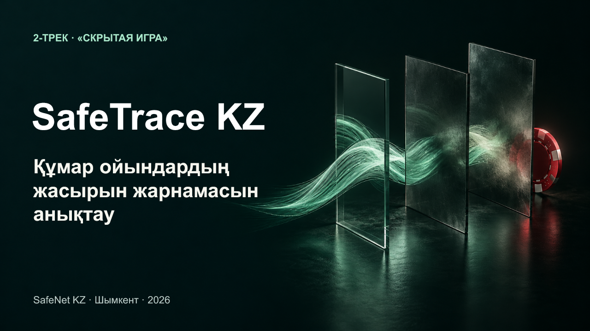

# SafeTrace KZ · Қазақша қорғау

**Құмар ойындардың жасырын жарнамасын анықтау.** 2-трек «Скрытая игра».

12 слайд: негізгі қорғауға 10 слайд және жюри сұрақтарына 2 қосымша. [Қазақша сөйлеу мәтіні](PITCH_KK.md) бес минутқа жоспарланған; ұзақтығы репетициямен өлшенген жоқ. Өңделетін презентация осы тапсырманың Spaces құжатында сақталған. Бұл папкада оның мәтіні мен құрастыру көзі бар; PPTX/PDF экспорты бұл итерацияда жасалған жоқ.

## Негізгі желі

Хабарламада «казино» сөзі жоқ. OCR суреттен қазақша мәтін мен URL-ді оқиды. Сілтемелер картасы аралық бетті және ойын ұсынысына өтуді көрсетеді. Әр ұпай нақты дерекке сүйенеді, ал шешімді талдаушы қабылдайды. Қарсы мысал мен қателер негізгі қорытындының шекарасын көрсетеді.

Қосымша домен және құпия код белгілері негізгі тақырыпты толықтырады. Олар казиноға қатыстылықты өздігінен дәлелдемейді. Презентация 93,75% precision көрсеткішін жалпы дәлдік немесе жаңа сілтеменің ықтималдығы деп атамайды.

## Файлдар

- [PITCH_KK.md](PITCH_KK.md): тайминг жоспары, 12 слайдтың сөздері және дереккөздер.
- [speaker-notes.json](speaker-notes.json): презентациядан алынған сақталған ескертпелер.
- [deck-content.mjs](deck-content.mjs): Artifact Session үшін өңделетін мәтін, диаграмма, кесте және сілтемелер картасы. `addCover` бос слайдқа мұқаба жасайды; `addBatch` `{from:2,to:4}` сияқты аралықпен жалғастырады. Колбэктерді сол `artifactRef` арқылы бөлек шақыру керек.
- [Мұқаба иллюстрациясы](assets/cover-concept.png) және [оның промпты](assets/cover-prompt.md): built-in Imagegen арқылы жасалған тұжырымдамалық сурет. Нақты оқиғаның фотосы емес.

Диаграмма: v3 `[9, 9]`, v4 `[2, 10]` — жалған дабыл және өткізіп алу саны. Кесте: v3 TP31/FP9/TN31/FN9; v4 TP30/FP2/TN38/FN10. Олардың деректері өңделетін нысандарда сақталған.

## Дерек пен қолдану шекарасы

[v4 бағасы](../../reports/EVALUATION_V4.md) 80 авторлық синтетикалық жағдайға қатысты. [HTTPS көрсетілімі](../../reports/PUBLIC_DEMO_2026_10_24.md) нақты OCR қолданады, бірақ маршрут пен беттер синтетикалық. Физикалық телефон тексерілген жоқ. Мәтіндегі ескерту мысалы орысша тексерілген материалдан мағыналық аударма ретінде берілген.

Қолданба скриншоттары — түпнұсқа орысша интерфейстің үзінділері. Негізгі слайд мәтіні мен сөйлеу мәтіні қазақша. Кіру коды, жеке база мен құпия кілттер бұл папкаға кірмейді.
