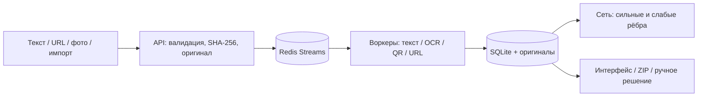

# Архитектура SafeTrace KZ 3.0

Основной сценарий — трек 2 «Скрытая игра». Локальный FastAPI отдаёт интерфейс и API; Redis Streams распределяет задания между 1–4 процессами; SQLite и файлы хранят материалы, наблюдения, решения и экспорт. [Измеренная схема нагрузки](DEPLOYMENT_PLAN.md).

| Компонент | Файл | Роль |
|---|---|---|
| API и ограничения | [`backend/app.py`](../backend/app.py), [`backend/limits.py`](../backend/limits.py) | Локальный HTTP, загрузки, задания, чтение результатов |
| Очередь | [`backend/queue_store.py`](../backend/queue_store.py), [`scripts/run_worker.py`](../scripts/run_worker.py) | Redis Streams, lease, повторный захват, ограничение 128 активных |
| Анализ | [`backend/pipeline.py`](../backend/pipeline.py), [`backend/analysis.py`](../backend/analysis.py) | Материал, признаки, контекст, приоритет, источники |
| Изображения | [`backend/image_triage.py`](../backend/image_triage.py), [`backend/ocr.py`](../backend/ocr.py), [`backend/qr.py`](../backend/qr.py) | Дешёвая проверка кадра; реальный OCR и QR по необходимости |
| Ссылки | [`backend/links.py`](../backend/links.py), [`backend/ocr_urls.py`](../backend/ocr_urls.py) | Разрешённый обход, URL из OCR и остановка сомнительных адресов |
| Сеть | [`backend/network.py`](../backend/network.py), [`backend/network_signals.py`](../backend/network_signals.py) | Точные и слабые рёбра, группы, PageRank |
| Данные и экспорт | [`backend/storage.py`](../backend/storage.py), [`backend/exports.py`](../backend/exports.py) | SQLite/WAL, исходники, HTML/JSON/ZIP |
| Интерфейс | [`frontend/src/`](../frontend/src/) | Ввод, причины, источник, сеть, ручное решение |

Оригиналы живут в локальном томе и не включаются в GitHub Pages. Статическая страница показывает готовые учебные случаи и отдельно выполняет упрощённый JS-скоринг **нового текста в браузере**, без серверного OCR или обхода URL. [Матрица возможностей](LOCAL_AND_ONLINE.md).

Сетевой обход по умолчанию выключен и допускается только при включении сети и точном allowlist. Он повторно проверяет URL, DNS, порт, TLS и ограничения размера/глубины. Исходный текст отличается от нормализованного; цитаты сохраняют координаты в оригинале. Недостаток данных отображается отдельно от низкого приоритета. [Объяснение механизма](METHODOLOGY.md), [единые ограничения](LIMITATIONS.md).

Архитектура выпуска 2.4 сохранена в [архиве](archive/ARCHITECTURE_V2_4.md).
