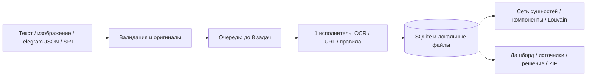
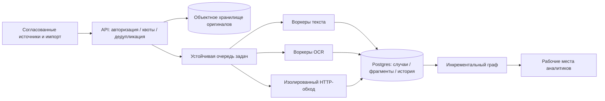

# План внедрения и масштабирования

## Что работает сейчас

Одна рабочая станция, SQLite/WAL, один исполнитель OCR, очередь до 8 активных/ожидающих задач. JSONL объединяет до 20 материалов в случай. Импорт Telegram JSON и SRT разбивает до 1000 сообщений на такие пакеты, последовательно подаёт их локальному серверу и сохраняет квитанции. Это ограниченный пакетный режим с обратным давлением, а не распределённая платформа.

## Предлагаемая архитектура пилота

Второй рисунок — план. Postgres, внешняя очередь, несколько воркеров, роли и объектное хранилище пока не внедрены.

Перед переходом: идемпотентный ключ задания; подтверждение после сохранения; повтор с backoff; отдельная очередь ошибок; лимит OCR по памяти; таймауты и квоты сети; сроки хранения; резервное копирование и восстановление; аудит доступа. Ручное решение хранится отдельно от автоматического результата.

## Как оценивать пропускную способность

Разделять четыре замера: чистый текст, тёплый OCR, холодный запуск модели, очередь вместе с ожиданием. Отдельно указывать размер изображений, CPU, число потоков, p50/p95 и число отказов. Внешняя сеть измеряется независимо и имеет собственные квоты.

На историческом synthetic-v4 p50 полного процесса 4,08 мс, p95 7,25 с при смешении текста и изображений. Эти числа нельзя преобразовывать в «постов в секунду» для потока изображений. [Детальные измерения](METRICS.md).

Новая структурная сеть: 96 материалов / 446 сущностей, [фактическое время сборки](../reports/release-2.4/network-benchmark.json). Замер касается графа из уже извлечённых сущностей, без OCR, сети и ввода браузера.

## Поставка

- [Локальная установка и перенос](INSTALL_AND_TRANSFER.md): основной способ работы.
- [Docker](DOCKER.md): контейнер CPU и постоянный том данных; отдельная проверка в CI.
- [Постоянная статическая демонстрация](https://nurbolidze121212.github.io/safetrace-kz/): сохранённые учебные результаты, без серверной загрузки новых материалов.
- [Временный HTTPS-стенд](PUBLIC_DEMO.md): отдельный экземпляр с кодом доступа для показа живого OCR.

Пилот следует начинать с одного согласованного источника, независимой разметки и фиксированного времени аналитика на случай. Количество просмотренных материалов само по себе не измеряет общественную пользу или предотвращённый ущерб.
