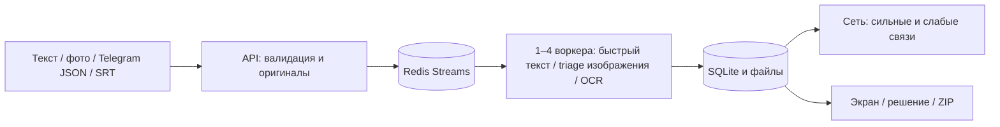

# Работающий контур и границы пилота

В текущем Compose есть API, Redis Streams с подтверждением/повторным захватом, 1–4 отдельных воркера, SQLite/WAL и локальные файлы оригиналов. API доступен только по `127.0.0.1:8765`, Redis наружу не опубликован. Готовый amd64 CPU-образ уже содержит OCR-модели; [точный запуск](DOCKER.md). Данные остаются на компьютере владельца.

[Фактический замер 1→4](SCALE_BENCHMARK_V5.md) получен в Linux CI на 4 vCPU. Текст: 22,94→41,00 случаев/с; OCR: 0,434→0,662 изображения/с на конечных пакетах. p50/p95 и условия в отчёте. Четыре OCR-воркера на таком CPU почти не ускоряют обработку относительно двух. [Структурная сеть](NETWORK_V5.md) измерена отдельно от OCR и HTTP.

SQLite остаётся единым узлом записи; в нескольких машинах этот Compose не работает как распределённая система. Для пилота с согласованными источниками нужны разграничение доступа, хранение оригиналов, резервная копия, квоты, наблюдаемость и отдельно измеренная нагрузка реального потока. Postgres или объектное хранилище здесь не внедрены. [Ограничения](LIMITATIONS.md).

Историческая схема до Redis сохранена в [архиве](archive/DEPLOYMENT_PLAN_V2_4.md).
