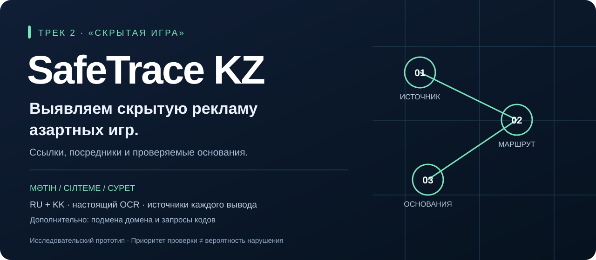
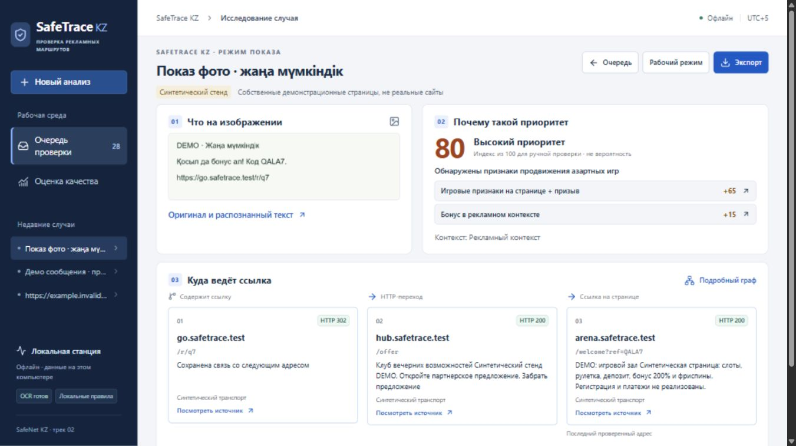
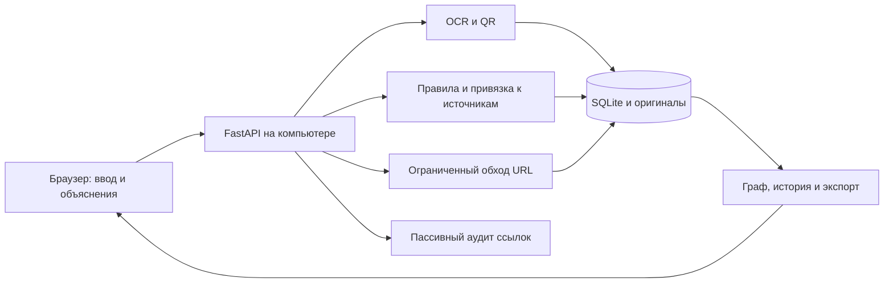

# SafeTrace KZ — выявление скрытого продвижения азартных игр

### Трек 2 «Скрытая игра»: от замаскированной рекламы к проверяемому маршруту.

**[Запустить на Windows](../INSTALL_AND_TRANSFER.md) · [Показать с телефона](../PUBLIC_DEMO.md) · [Для жюри](../FOR_JUDGES.md) · [Қазақша қорғау](../../deliverables/kazakh-jury-2026-10-24/README.md) · [Проверить результаты](../../reports/EVALUATION_V4.md)**

**Основная версия — локальная установка на вашем компьютере. Онлайн-доступ — ограниченная демонстрация.** В демо работают настоящий OCR, локальный анализ, учебная карта и экспорт, но внешние сайты не запрашиваются. [Подробное сравнение: что можно локально и онлайн](../LOCAL_AND_ONLINE.md).

**Статус онлайн-доступа на 25.10.2026:** прежний временный адрес не открылся; демонстрационный сервер на компьютере автора не запущен. Постоянного сайта пока нет. Для собственного запуска используйте [инструкцию Windows](../INSTALL_AND_TRANSFER.md), для показа по ссылке — [отдельный HTTPS-стенд](../PUBLIC_DEMO.md). Успешный внешний показ 24.10.2026 сохранён в отчёте; он не означает доступность сервера сегодня.

**Публикация или скриншот → ссылка → посредник → игровой ресурс → основания для ручной проверки.**

SafeTrace KZ выявляет признаки **скрытого продвижения онлайн-казино и азартных игр** в текстах, ссылках и изображениях. Проект создан для **трека 2 «Скрытая игра» SafeNet KZ**: восстановить рекламный маршрут, найти посредников и реферальные связи, объяснить вывод конкретными источниками.

**Дополнительный анализ внутри того же случая:** приложение **2.3.0** отмечает подмену домена, ссылки на исполняемые файлы и сочетание обещания приза с запросом пароля или SMS-кода. Эти экспериментальные проверки помогают разбирать сопутствующие признаки обмана в исследуемых материалах. Их результаты показываются отдельно и сами по себе не устанавливают связь с казино.

**Қазақша:** SafeTrace KZ — онлайн-казино мен құмар ойындардың жасырын жарнамасын анықтауға арналған жоба. Негізгі міндеті — жарнамалық сілтеменің бағытын қалпына келтіріп, қорытындының негізін көрсету. Сол материалдардағы доменді бүркемелеу және құпия кодты сұрау сияқты қосымша белгілер бөлек көрсетіледі. Соңғы шешімді адам қабылдайды.

**English:** Detecting hidden online-casino and gambling promotion — SafeNet KZ, Track 2. OCR, intermediary routes and referral links lead back to source evidence. Experimental checks for deceptive domains and requests for secrets supplement the same case; they do not establish gambling involvement on their own.



## Главная задача: раскрыть скрытое продвижение азартных игр

Сообщение «забери бонус» может не содержать слова «казино». Ссылка проходит через посредника и только затем приводит к игровому предложению. Обратная ситуация — новость или предупреждение, где те же слова не являются рекламой. SafeTrace сохраняет материал, показывает проверенные переходы и связывает вывод с конкретными фрагментами.

При исследовании того же сообщения дополнительный аудит может отметить просьбу отправить код или вводящий в заблуждение адрес. Основной результат отвечает на вопрос о продвижении азартных игр; дополнительные признаки имеют собственные основания и статусы. [Границы дополнительной проверки](../EXTENDED_ANALYSIS.md).

## Почему этот проект заслуживает внимания

**Ссылка — начало расследования.** SafeTrace восстанавливает цепочку «публикация → посредник → игровая страница» и показывает, какая часть маршрута действительно наблюдалась. HTTP-переход, ссылка в HTML и предположение остаются разными сущностями.

**Каждый вывод можно открыть.** Нажатие на причину приоритета показывает цитату, оригинал, координаты OCR или сохранённое наблюдение. Повторяющийся признак сохраняет все независимо подходящие источники. Аналитик может проверить результат и оставить решение, которое не переписывает автоматическую оценку.

**Контекст влияет на вывод.** Русские и казахские сообщения, предупреждения и новости входят в проверочные сценарии. На фиксированном авторском наборе v4 ложные тревоги снизились с 9 до 2 из 40 отрицательных случаев; пропуски при этом выросли с 9 до 10. Мы публикуем этот компромисс вместе с ошибками и исходными результатами.

**Показ проходит через весь продукт.** Фото → настоящий OCR → признаки → карта → первоисточник → ZIP с JSON, HTML и оригиналами. Интерфейс работает в браузере; для телефона подготовлен отдельный HTTPS-стенд с кодом доступа и отдельными данными. [Проверка публикации](../../reports/PUBLIC_DEMO_2026_10_24.md).

Эти свойства — аргументы в пользу практической ценности. Сравнение с другими участниками или гарантия первого места не проводились. [Соответствие каждому критерию исходного PDF](../FOR_JUDGES.md).

## Локально и онлайн: возможности различаются

| Возможность | Локальная установка | Онлайн-демо |
|---|---|---|
| Назначение | Рабочее место для собственных случаев и полного реализованного процесса | Короткий показ на учебных материалах |
| OCR, текст, источники, история, экспорт | Доступны после установки и запуска | Доступны, когда стенд включён и выполнен вход по коду |
| Внешние сайты | Ограниченный HTTP-обход только при разрешённой сети и настроенном списке узлов | Не открываются; анализируются предоставленный текст/фото и форма адреса |
| Полный учебный маршрут | Синтетический стенд `.test` | Синтетический стенд `.test`, без проверки реальных казино |
| Данные и доступность | Ваша база; сервер работает на вашем компьютере | Отдельная общая очередь; временный адрес зависит от компьютера автора |

Локальная установка тоже имеет границы: нет подключённого антивируса, репутационных баз и автоматической проверки лицензий. «Не найдено признаков» не равно «безопасно». [Полная матрица, примеры и ограничения](../LOCAL_AND_ONLINE.md).

## Основной сценарий трека 2: что реализовано

| Возможность | Фактическое состояние |
|---|---|
| Текст, URL, PNG/JPEG/WebP, вставка картинки, JSONL | Работает локально |
| OCR и QR, оригиналы и координаты | Работает; сомнительные адреса требуют явной сверки |
| Признаки скрытого продвижения RU/KK | rules-4.0; измерено на авторском синтетическом наборе |
| HTTP-переходы и ссылки на страницах | Ограниченный обход разрешённых узлов; видимые остановки |
| Карта, основания и связанные материалы | Каждый шаг открывает сохранённый источник |
| История, решение, HTML/JSON/оригиналы в ZIP | Работает; manifest с размерами и SHA-256 |
| Телефон | HTTPS-стенд с кодом доступа; браузерный сценарий и ширина 390 px проверены. Физический телефон пока не испытан |
| Расширение браузера / чтение WhatsApp | **Не реализованы**; материал добавляется вручную |

### Дополнительно: признаки обмана в исследуемых материалах

| Проверка внутри случая | Фактическое состояние |
|---|---|
| Подмена домена, адрес исполняемого файла, «приз + запрос секрета» | Экспериментальный `link-audit-1.0.1`; свои основания и отдельный JSON |
| Сопоставление с доменом бренда | Один проверенный пример Apple; каталог казино не создан |
| Репутационные базы, антивирус, владелец и лицензия | Репутационные базы не подключены; остальные проверки автоматически не выполняются |

Качество дополнительного модуля пока не измерено на отдельном независимом корпусе. Метрики ниже относятся к основной задаче скрытого продвижения азартных игр.

## Что означает 80 или 100

Основной индекс **0–100 — приоритет ручной проверки, а не вероятность**. Игровые признаки на странице вместе с относящимся к ней призывом дают +65; бонус в рекламном контексте — +15. Результат 80 не означает «80% мошенничество». Даже индекс 100 не подтверждает преступление, вирус, владельца или лицензию.

В дополнительном аудите процент не выводится: для этих угроз пока нет отдельного корпуса и калиброванной модели. Показываются признаки, источники и состояние каждой проверки. [Методика](../METHODOLOGY.md) · [Исследовательское досье](../RESEARCH_DOSSIER.md).

## Быстрый запуск

Нужны Windows x64, Python **3.12 x64**, Node.js **22.12+**. Проверенные версии: Python 3.12.14 и Node 24.13.1. Первичная установка требует интернета. Распакуйте исходники в ASCII-путь, например `C:\SafeTrace-KZ`.

```powershell
cd C:\SafeTrace-KZ
powershell -NoProfile -ExecutionPolicy Bypass -File .\scripts\setup.ps1
powershell -NoProfile -ExecutionPolicy Bypass -File .\scripts\start.ps1 -Offline -Background
```

Откройте **[http://127.0.0.1:8765](http://127.0.0.1:8765)**. Один локальный процесс отдаёт сайт и API. Остановка:

```powershell
powershell -NoProfile -ExecutionPolicy Bypass -File .\scripts\stop.ps1
```

[Установка, проверка и перенос на другой компьютер](../INSTALL_AND_TRANSFER.md). Офлайн-режим не проверяет внешние сайты; демонстрационные `.test` обслуживаются собственным синтетическим транспортом.

## Первый показ за три шага

1. Нажмите **«Проверить сообщение»**. В «Название, источник и настройки» выберите **«Синтетический стенд»**, загрузите `examples/import/picture.png`, оставьте поля текста и URL пустыми.
2. После OCR откроется режим показа: фото, рассчитанный приоритет, причины и карта. Нажмите причину или узел, откройте оригинал. На одном проверенном проходе фото обрабатывалось 12,4 с; это не гарантия времени любого файла.
3. Покажите контрпример **«Похожее ≠ продвижение»**: предупреждение с похожими словами и адресом. Затем скачайте основное досье через «Экспорт». Это завершает показ основного сценария трека 2.

После основного сценария можно открыть вкладку **«Другие признаки: подмена домена и запросы кодов»** и отдельный JSON. Учебный пример дополнительного аудита: `Вы выиграли iPhone! Отправьте код из SMS: https://apple.com.claim.example/prize`. Он показывает возможности вспомогательного модуля; связи этого примера с казино не установлено. [Сценарий защиты](../MESSAGE_DEMO.md).

## Результаты основной задачи: скрытое продвижение азартных игр

Итоговый набор v4: **80 новых авторских синтетических случаев**, 40 положительных / 40 отрицательных, 32 изображения. Одинаковые входы для v3 и v4; независимой человеческой разметки нет.

| Метрика | v3 | v4 |
|---|---:|---:|
| TP / FP / TN / FN | 31 / 9 / 31 / 9 | 30 / 2 / 38 / 10 |
| Precision | 77,5% | **93,75%** |
| Recall | 77,5% | **75%** |
| False positive rate | 22,5% | **5%** |
| Recall на изображениях | 75% | **62,5%** |

Цели precision ≥95% и recall ≥80% не достигнуты. Шесть положительных отказов включены в FN. Подсказка для ручного уточнения OCR не считается автоматическим успехом. Эти метрики **не измеряют новый аудит угроз**. [Протокол](../EVALUATION_PROTOCOL_V4.md) · [оценка](../../reports/EVALUATION_V4.md) · [все ошибки](../../reports/ERROR_ANALYSIS_V4.md).

## Сервер у вас, браузер — интерфейс



Ключи, модели и база находятся на сервере. GitHub хранит исходники, но сам не запускает этот Python-сервер. Другой ПК может стать самостоятельным сервером. [HTTPS-доступ с телефона](../PUBLIC_DEMO.md) использует отдельный процесс и демонстрационную базу; компьютер должен оставаться включённым. [Архитектура](../ARCHITECTURE.md).

## Документация

| Вопрос | Материал |
|---|---|
| Отличия локальной версии от онлайн-демо | [Возможности и ограничения](../LOCAL_AND_ONLINE.md) |
| Проблема, гипотезы, эксперименты и ограничения | [Исследовательское досье](../RESEARCH_DOSSIER.md) |
| Скачать, запустить, перенести, восстановить | [Установка и перенос](../INSTALL_AND_TRANSFER.md) |
| Сервер, данные, ограничения сети | [Архитектура](../ARCHITECTURE.md) |
| Другие угрозы, реальные источники, API | [Расширенный анализ](../EXTENDED_ANALYSIS.md) |
| Показ продукта | [Демонстрация](../MESSAGE_DEMO.md) |
| Защита по критериям оригинального PDF | [Материалы для жюри](../FOR_JUDGES.md) |
| HTTPS-сайт, телефон, запуск и остановка | [Публичный показ](../PUBLIC_DEMO.md) |
| Подготовка GitHub | [Публикация](../GITHUB_PUBLICATION.md) |
| Реально выполненные проверки 2.3.0 | [Отчёт](../../reports/LINK_AUDIT_2_3.md) |
| Следующие шаги | [Дорожная карта](../ROADMAP.md), [ночные итерации](NIGHT_IMPROVEMENT.md) |
| Прежняя защита v4 | [PDF](../../output/pdf/SafeTrace-KZ-report-v4.pdf), [слайды](../../deliverables/SafeTrace-KZ-defense-v4.pptx), [архив README](README_V4.md) |

Исправление от 23.10.2026: одинаковый признак сохраняет ссылки на все подходящие источники. [Фактическая проверка патча](../../reports/NIGHT_EVIDENCE_2026_10_23.md): 334 backend-теста, браузер и скачивание JSON. Прежний архив 2.3.0 сохранён отдельно и этот патч не содержит.

## Разработка и проверка

```powershell
.\.venv\Scripts\python.exe -m pytest -q
.\.venv\Scripts\python.exe -m ruff check backend tests scripts
npm.cmd --prefix frontend test
npm.cmd --prefix frontend run lint
npm.cmd --prefix frontend run build
.\.venv\Scripts\python.exe scripts\preflight.py --server
```

24.10.2026 выполнено **352 backend-теста**, включая 18 проверок границы доступа нового стенда. Последний запуск **30 frontend-тестов — 22.10.2026**; клиентский код с того момента не менялся. Тесты проверяют поведение кода, а не заменяют независимую оценку точности. API-схема доступна у локального сервера в `/docs` и `/openapi.json`; в демонстрационном gateway эти служебные страницы закрыты.

`backend/` — сервер; `frontend/` — интерфейс; `tests/` — проверки; `fixtures/` — собственный стенд и справочник; `datasets/` — авторские наборы; `reports/` — измерения; `scripts/` — установка и обслуживание; `docs/` — объяснения. Модели скачиваются по `models-manifest.json` с проверкой SHA-256.

## Данные и воспроизводимость

Рабочая база, пользовательские оригиналы, `.env`, ключи, журналы и окружения исключены из Git. Локальный режим не отправляет материалы в облако. Режим Gemini отдельно отмечен в форме и требует серверного ключа; его живой вызов в приёмке не проверен.

Исходники и данные передаются отдельно. [Резервирование](../BACKUP.md) проверяет SQLite, SHA-256 и исторические изображения. Хеш подтверждает целостность байтов, а не истинность заключения.

[Лицензии компонентов и происхождение данных](../SOURCES_AND_LICENSES.md). Лицензия собственного кода пока отдельно не выбрана; наличие исходников на GitHub само по себе не объявляет свободную лицензию. Исторические отчёты сохранены с исходными ограничениями.
