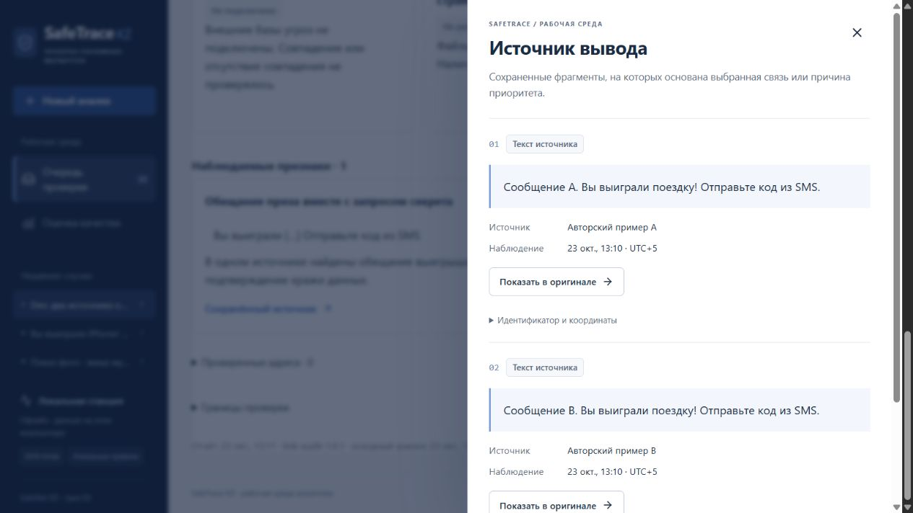

# Источники повторяющихся признаков — 23.10.2026

Автоматическая итерация началась по сигналу 08:04 UTC / 13:04 Asia/Qyzylorda. Исходное состояние: чистая ветка `codex/extended-link-audit`, коммит `ca49e99`; remote отсутствует. Приложение не слушало порт 8765. Один завершённый объём работы: исправить потерю источников у повторяющихся признаков дополнительного аудита.

## Дефект и исправление

Два независимых материала могут содержать одинаковые совпавшие фразы. `link-audit-1.0` сводил одинаковый признак в одну карточку и сохранял только evidence IDs первого материала. Если у первого не было пригодной ссылки на доказательство, карточка оставалась вообще без источника, хотя во втором он был.

На новом авторском примере «Вы выиграли поездку! Отправьте код из SMS» ожидались `e1` и `e2`, возвращался только `e1`: [воспроизведение](night-evidence-2026-10-23/before.json). Четыре новые проверки сначала упали: [регрессия до исправления](night-evidence-2026-10-23/regression-before.txt).

В `link-audit-1.0.1` одинаковые признаки по-прежнему отображаются один раз, но их существующие evidence IDs объединяются без повторов. Порядок материалов не меняет набор источников. Предупреждения исключаются прежним правилом, несуществующие ID не добавляются; отдельные материалы по-прежнему должны самостоятельно содержать оба текстовых признака. Баллы и игорный классификатор не менялись.

## Проверка

- Целевой модуль: **19 passed за 4,07 с**. Добавлены четыре проверки RU/KK, повторов между текстом/OCR/сохранённой страницей, исключения предупреждения и восстановления ссылки после первого материала без evidence.
- Весь backend: **334 passed за 240,92 с**, одно предупреждение Paddle об отсутствии ccache. [Полный вывод](night-evidence-2026-10-23/backend-tests.txt).
- `python -m ruff check backend tests scripts` прошёл. [Preflight](night-evidence-2026-10-23/preflight.json) сверил модели, зависимости, frontend fingerprint и локальный сервер. Frontend не менялся; его тесты в этой итерации повторно не запускались.
- Через настоящий локальный API создан один авторский случай с двумя материалами. Основной анализ завершён; дополнительный аудит возвращает один признак и два источника, `probability=null`, новых сетевых запросов 0.
- В браузере кнопка «Сохранённый источник» действительно открыла сообщения A и B с разными названиями источника. JSON скачан через интерфейс и проверен: обе ссылки сохранены. Ошибок/предупреждений консоли нет. Первое создание вкладки завершилось тайм-аутом; созданная вкладка затем повторно подключена, навигация и проверка прошли.

[Открыть авторский пример](http://127.0.0.1:8765/#case/3ac737749a18470a9cfc4c97b4ac6218?view=security) · [входные материалы](night-evidence-2026-10-23/browser-case-input.json) · [скачанный JSON](night-evidence-2026-10-23/browser-export.json) · [машинная проверка](night-evidence-2026-10-23/verification.json).

## Сохранность и границы

До изменений создана и штатно проверена копия `data/backups/before-audit-evidence-2026-10-23.zip`. Все 29 прежних случаев, 9 решений, 13 cache-записей и 10 оригиналов побайтно сохранены. Сейчас 30 случаев: добавлен один авторский пример, новых решений нет. Сервер запущен штатным `scripts/start.ps1 -Offline -Background` на loopback 127.0.0.1:8765; приложение остаётся 2.3.0, версия отдельного модуля — 1.0.1.

Замороженные файлы v4 не менялись в этой итерации. Отличие app.py от исходного freeze возникло в предыдущей версии 2.3.0. Старые выпуски, ZIP и финальные оценки сохранены; архив 2.3.0 не содержит сегодняшнего патча. Нового измерения точности, отдельного OCR-эксперимента, интеграции репутационных баз или публикации на GitHub не проводилось.

Следующий ограниченный шаг — точнее выделять OCR-строки, поддерживающие признак, на новых авторских dev-примерах; текущая проверка OCR использует сохранённый распознанный текст, а не новое распознавание фотографии.
