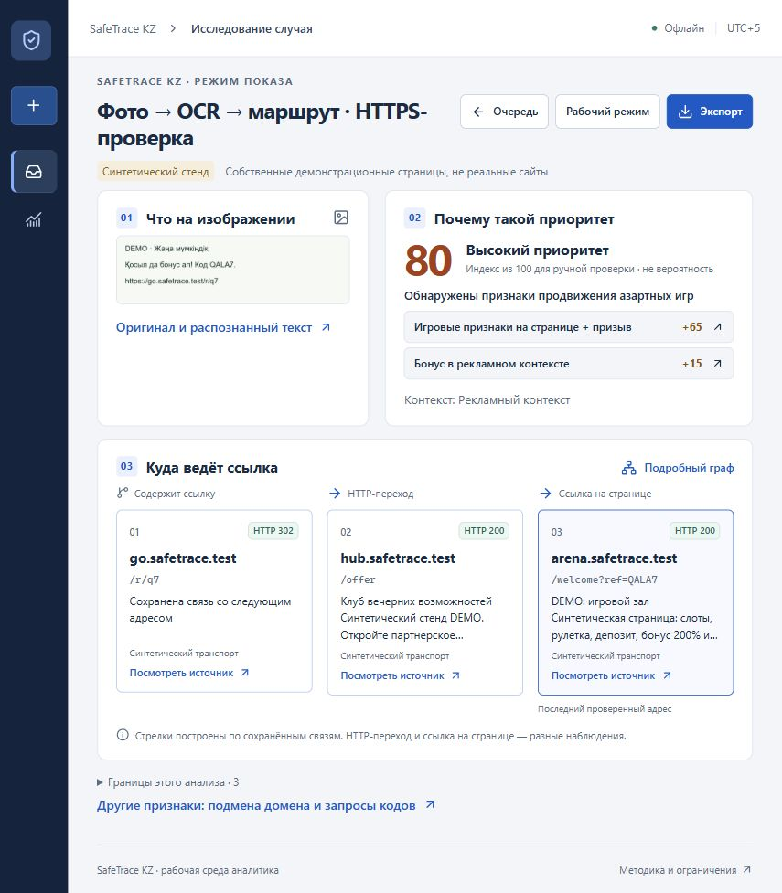

# SafeTrace KZ: внешний сайт и подготовка GitHub · 24.10.2026

## Реально выполнено

Создан отдельный HTTPS-стенд с настоящим FastAPI/OCR backend на компьютере автора. Cloudflare Quick Tunnel направлен на выделенный loopback-порт 8770; обычный сервер 8765 и рабочая база не являются его целью. База стенда создана с нуля в `data/public-demo/<ID>`; в неё через браузер загружен только собственный учебный пример.

Добавлены `backend/demo_gateway.py`, запуск `scripts/run_public_demo.py`, команды `start_public_demo.ps1` / `stop_public_demo.ps1`, воспроизводимая проверка `check_public_demo.py` и инструкция [PUBLIC_DEMO](../docs/PUBLIC_DEMO.md). Секреты сессии находятся в игнорируемом `logs/`, не в публикации. Сайт требует отдельный код; очередь общая для его участников.

Старт внешнего приложения первоначально отклонила автоматическая проверка разрешений. После явного подтверждения пользователем способа публикации запуск разрешён и выполнен. Первый предварительный туннель был остановлен без доступного приложения. Публикация Vercel не выполнялась: API распознал аккаунт, но доступ к выбранному workspace вернул 403. Отказ не обходился изменением команды или чужим аккаунтом; использован отдельно подтверждённый демонстрационный способ.

## Проверки

| Проверка | Результат и границы |
|---|---|
| Полный backend pytest | **352 passed**, 1 предупреждение о необязательном ccache, 80,27 с |
| Gateway | **18 passed**; авторизация, подмена Host/Origin, истечение/подделка cookie, logout, лимиты, изоляция папки |
| Ruff | `backend tests scripts` — passed |
| Preflight | Python, зависимости, 9 файлов OCR по SHA-256, frontend fingerprint, SQLite — passed |
| Настоящий OCR через gateway в процессе теста | Фото без текста, completed, 4,48 с; 21 evidence, 13 узлов; ZIP. Личная SQLite побайтно не изменилась |
| Внешний HTTPS | Страница входа 200, анонимный API 401, вход 303, авторизованный health 200, offline=true |
| Браузер по публичному URL | Загружен `examples/import/picture.png`, без добавленного текста; новый анализ completed, серверное время 5,5575 с |
| Видимый результат | Индекс 80 = +65/+15; три шага синтетического маршрута; причина открывает OCR, исходное изображение и сохранённые страницы |
| Экспорт из браузера | Реально скачан ZIP, 37 960 байт, 5 файлов; размеры и SHA-256 всех записей manifest проверены |
| Мобильная ширина | Проверен viewport 390×844; горизонтальное переполнение не выявлено. Физический телефон не использовался |
| Запуск/остановка скриптами | Отдельный стенд на 8771 запущен, внешний login 200; его два процесса остановлены с проверкой PID/времени. Основной показ на 8770 оставлен работающим |

В реальном браузере обнаружен и исправлен дефект входа: `Referrer-Policy: no-referrer` превращал Origin нативной формы в `null`. Gateway теперь использует `same-origin`, а строгая проверка Origin сохранена. После изменения 18 gateway-тестов повторно прошли и браузерный вход с обработкой фото завершился.

В ходе проверки команд исправлены два Windows-случая: ещё пустой лог туннеля и автоматический разбор ISO-дат `ConvertFrom-Json` в PowerShell 7. Остановка сравнивает UTC ticks, сохраняя защиту от повторного использования PID.

[Локальная интеграция](public-demo-2026-10-24/local-integration.json) · [Preflight](public-demo-2026-10-24/preflight.json) · [Проверка состава публикации](public-demo-2026-10-24/publication-scan.json).

[Мобильный снимок](public-demo-2026-10-24/https-mobile.png).

## Оформление для жюри

Первый push **успешно завершён**: [nurbolidze121212/safetrace-kz](https://github.com/nurbolidze121212/safetrace-kz), ветка `main`, реализация `0a8d127`. Загружена история проекта, исходники, тесты, авторские наборы и отчёты. В браузере проверены дерево файлов, README, изображение обложки и ссылки на документацию. Рабочие данные, модели, окружение и код доступа в Git не включены. Модели устанавливаются штатным setup из проверяемого манифеста.

Сканирование выбранных сигнатур секретов: 1103 файла текущего состава и 1817 объектов прежней истории, совпадений и запрещённых путей не найдено. Это ограниченная проверка, а не доказательство отсутствия любого возможного секрета. 59 локальных ссылок изменённых документов проверены, отсутствующих файлов нет.

Исходный PDF прочитан; визуально проверены страницы с треком и критериями. README получил обложку, объяснение ценности, измеренный компромисс качества и навигацию. [FOR_JUDGES](../docs/FOR_JUDGES.md) связывает шесть критериев PDF с реализованными функциями, отчётами и оставшимися ограничениями. Добавлена конкретная дорожная карта телефона и постоянного сервера.

Правила, OCR, веса и pipeline не изменены. Метрики frozen v4 не переоценивались; 93,75% precision на авторской синтетике не превращается в вероятность любого нового случая. Прежние выпуски и рабочие материалы не перезаписаны.

## Эксплуатационные ограничения

Текущий адрес временный, зависит от работы компьютера, сети и процессов. Это не постоянный хостинг. Все получатели кода видят общую демонстрационную очередь. Внешние сайты, облачная модель и репутационные источники в стенде не запрашиваются. Нет антивируса, автоматической проверки лицензии, универсального антифишинга, личных кабинетов или проверки на реальном телефоне.

Адрес и код показываются пользователю отдельно; код не публикуется в Git. Условия передачи запросов через Cloudflare и команды остановки описаны в инструкции. Публичные источники и рабочие данные передаются отдельно.
